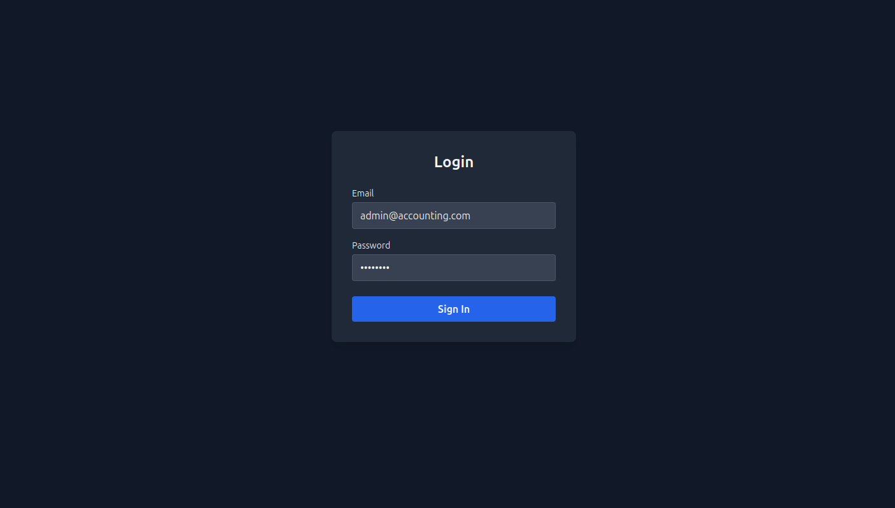
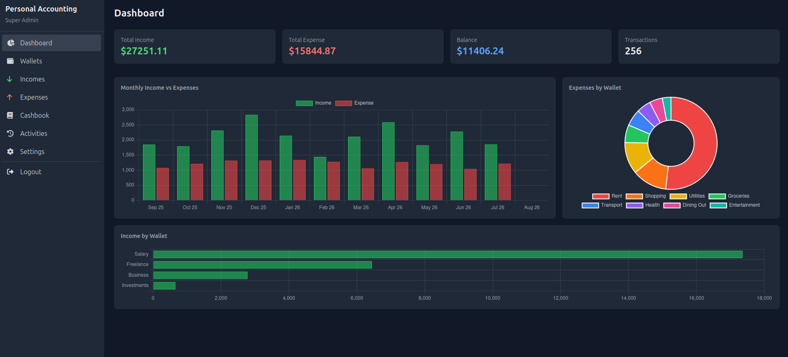
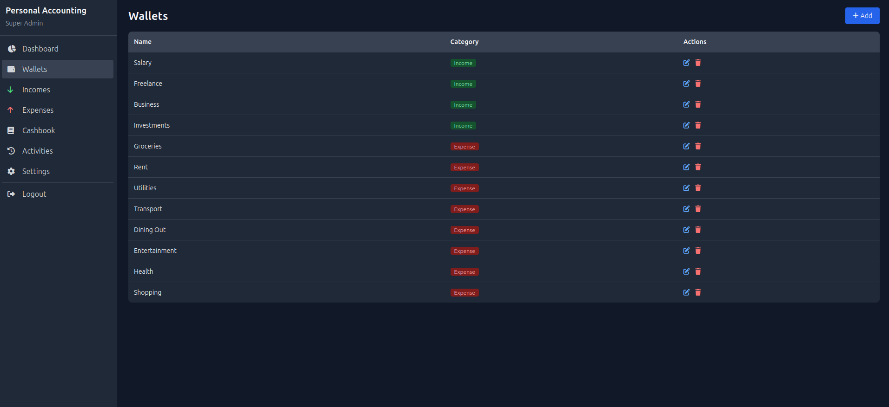
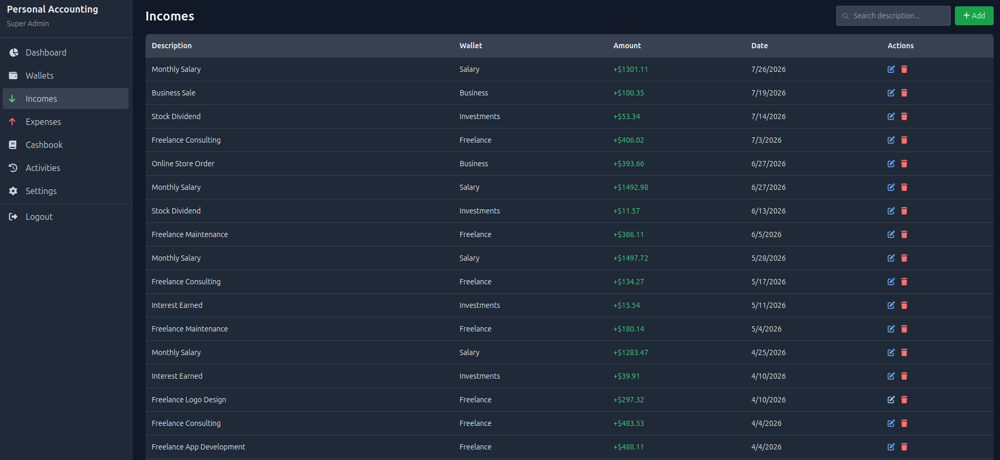
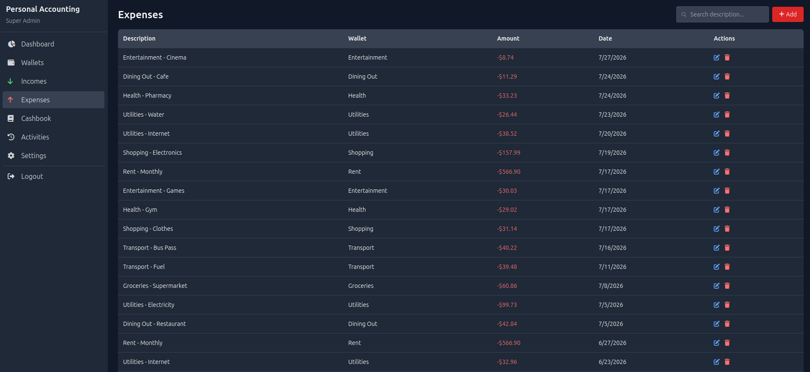
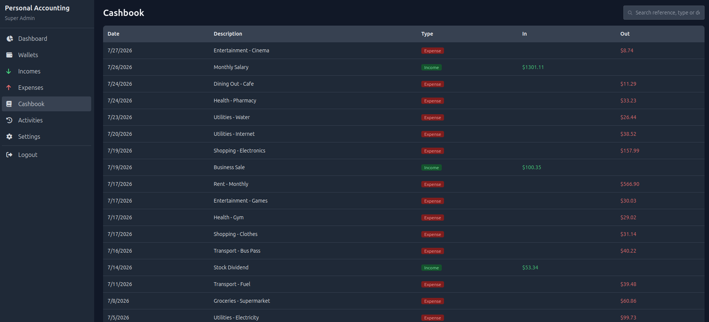
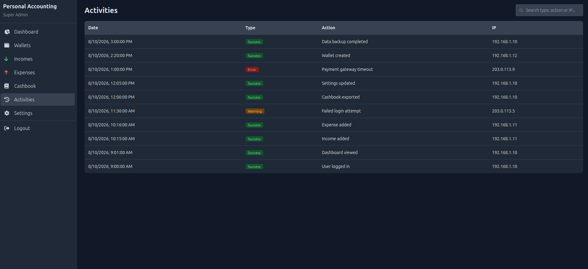
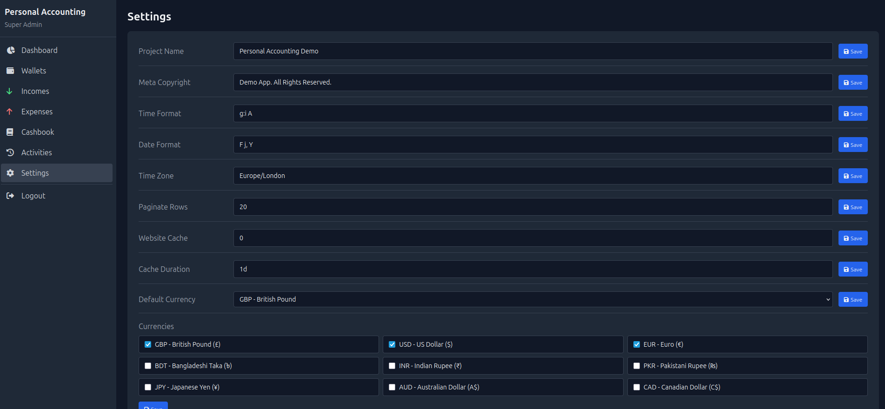

# Personal Accounting System

Self-hosted, API-first personal finance web app. Record incomes and expenses against wallets, with an automatic cashbook, audit trail, settings, and an analytics dashboard.

## Tech Stack


## Features

- **Dashboard** — total income / expense / balance + monthly and per-wallet charts (Chart.js)
- **Wallets** — income & expense categories
- **Incomes & Expenses** — full CRUD, each transaction auto-writes a cashbook entry
- **Cashbook** — automatic ledger with descriptions resolved from references
- **Activities** — audit trail (login, actions, IP)
- **Settings** — editable key/value configuration incl. selectable currencies
- Search (debounced) + pagination on every list

## Quick Start

```bash
docker compose up -d --build
```

| Service    | URL                   |
| ---------- | --------------------- |
| App        | http://localhost:8040 |
| phpMyAdmin | http://localhost:8041 |

Default login: `admin@accounting.com` / `password`

## Screenshots

### Login



### Dashboard



### Wallets



### Incomes



### Expenses



### Cashbook



### Activities



### Settings



## License

Proprietary.
